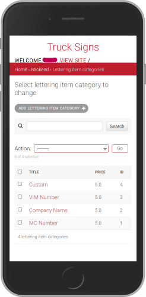
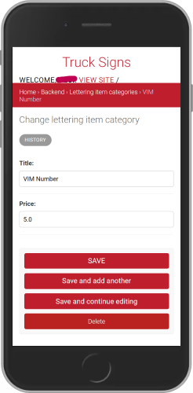
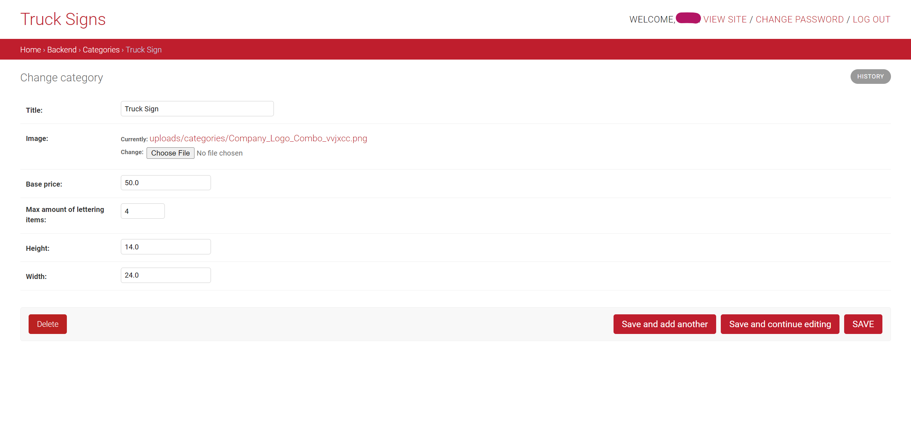

<div align="center">

# Signs for Trucks

  


__Signs for Trucks__ is an online store to buy pre-designed vinyls with custom lines of letters (often called truck letterings).
The store also allows clients to upload their own designs and to customize them on the website as well.

</div>

## Table of Contents

- [1. Description](#1-description)
- [2. Quickstart](#2-quickstart)
  - [2.1 Prerequisites](#21-prerequisites)
  - [2.2 How to Build the Image](#22-how-to-build-the-image)
  - [2.3 Start the Stack](#23-start-the-stack)
- [3. Usage](#3-usage)
  - [3.1 Environment Variables](#31-environment-variables)
  - [3.2 Docker Compose](#32-docker-compose)
  - [3.3 Docker Run](#33-docker-run)
  - [3.4 Entrypoint Script](#34-entrypoint-script)
  - [3.5 Data Persistence](#35-data-persistence)
  - [3.6 Customizing the Setup](#36-customizing-the-setup)
  - [3.7 Local Development without Containers](#37-local-development-without-containers)
- [4. Repository Structure](#4-repository-structure)
- [5. CI Pipelines](#5-ci-pipelines)
- [6. Screenshots of the Django Backend Admin Panel](#6-screenshots-of-the-django-backend-admin-panel)
  - [6.1 Mobile View](#61-mobile-view)
  - [6.2 Desktop View](#62-desktop-view)
- [7. Additional Information](#7-additional-information)

## 1. Description

This repository contains the backend of the __Signs for Trucks__ store:

- a __Django 5.2 / Django REST Framework__ API with the Django admin panel
- a __Dockerfile__ to build the backend image (`python:3.12-slim`)
- a __docker-compose.yml__ that runs the backend (served by __gunicorn__) together with a __PostgreSQL__ database
- an __entrypoint.sh__ that prepares the app on every container start
- __GitHub Actions__ workflows for linting, testing and building the image

The purpose of this repository is to run the API reliably and reproducibly as a containerized stack. There is no frontend.

## 2. Quickstart

### 2.1 Prerequisites

* [Docker Engine](https://docs.docker.com/engine/install/) with the Docker Compose plugin
* [Git](https://git-scm.com/install/)
* Port `8020` open in the firewall of the host / VM

### 2.2 How to Build the Image

1. Clone the repo:
```bash
git clone git@github.com:PariKhavari/truck_signs_api.git
cd truck_signs_api
```

2. Build the image:
```bash
docker build -t truck-signs-api:1.0 .
```

### 2.3 Start the Stack

1. Copy the content of the example.env file into a .env file and fill in your own values:
```bash
cp example.env .env
```

2. Start the database and the backend:
```bash
docker compose up -d
```

3. Check that both containers are running:
```bash
docker compose ps
```

4. Open the app in your browser: `http://<HOST_IP>:8020/admin`

> [!IMPORTANT]
> Add `<HOST_IP>` to `ALLOWED_HOSTS` in `.env`, otherwise Django answers with `400 Bad Request`.

## 3. Usage

### 3.1 Environment Variables

All configuration is passed via a `.env` file in the project root. Only the variable __names__ are documented here.

> [!CAUTION]
> Never commit the `.env` file. It is listed in `.gitignore` and `.dockerignore` to keep secrets out of the repository and the image.

1. Required variables:
    ```bash
    SECRET_KEY
    ALLOWED_HOSTS                 # e.g. localhost,<HOST_IP>

    DB_NAME
    DB_USER
    DB_PASSWORD
    DB_HOST                       # Compose service name: db
    DB_PORT                       # 5432

    POSTGRES_DB                   # same value as DB_NAME
    POSTGRES_USER                 # same value as DB_USER
    POSTGRES_PASSWORD             # same value as DB_PASSWORD

    DJANGO_SUPERUSER_USERNAME
    DJANGO_SUPERUSER_EMAIL
    DJANGO_SUPERUSER_PASSWORD
    ```
2. Optional variables (defaults are used if not set):
    ```bash
    BACKEND_PORT                  # host port of the backend, default 8020
    MODE                          # prod (default, PostgreSQL) or dev (SQLite, DEBUG on)
    DEBUG_ENABLED                 # default False
    LOG_LEVEL                     # default ERROR
    CORS_ALLOWED_ORIGINS          # default http://localhost:3000
    CLOUD_NAME, CLOUD_API_KEY, CLOUD_API_SECRET   # Cloudinary media storage
    EMAIL_HOST_USER, EMAIL_HOST_PASSWORD          # SMTP, currently disabled
    ```

> [!IMPORTANT]
> `DB_HOST` must be the Compose service name `db`, not `localhost`. Inside a container, `localhost` points to the container itself.

### 3.2 Docker Compose

```bash
docker build -t truck-signs-api:1.0 .   # build / rebuild the image
docker compose up -d                    # start db + backend in the background
docker compose logs -f backend          # follow the backend logs
docker compose down                     # stop and remove the containers (data is kept)
```

- Both services share the network `tsa-network`, so the backend reaches the database via the host name `db`.
- Both services use `restart: unless-stopped`, so a crashed container is restarted automatically.
- Both services read their configuration from `.env`.
- Only the backend publishes a port: `${BACKEND_PORT:-8020}:8000`. The database is not reachable from outside.
- The backend starts only after the database healthcheck (`pg_isready`) reports healthy.

### 3.3 Docker Run

The same setup with plain `docker run` (replace the placeholders, secrets come from `.env`):

```bash
docker network create tsa-network

docker run -d --name tsa_db \
  --network tsa-network \
  --env-file .env \
  -v postgres_data:/var/lib/postgresql/data \
  --restart unless-stopped \
  postgres:17-alpine

docker run -d --name tsa_backend \
  --network tsa-network \
  --env-file .env \
  -p <BACKEND_PORT>:8000 \
  -v media_data:/app/src/mediafiles \
  --restart unless-stopped \
  truck-signs-api:1.0
```

### 3.4 Entrypoint Script

`entrypoint.sh` runs on every container start:

1. waits (with `sleep`) until PostgreSQL accepts connections on `${DB_HOST}:${DB_PORT}`
2. runs `python manage.py migrate`
3. runs `python manage.py collectstatic --noinput` (static files are served by WhiteNoise)
4. creates the superuser from the `DJANGO_SUPERUSER_*` variables, __only if it does not exist yet__
5. starts the WSGI app with `exec gunicorn tsa_app.wsgi:application --bind 0.0.0.0:8000`

> [!NOTE]
> gunicorn is started only once, in `entrypoint.sh`. The development server (`runserver`) is not used in the container.

### 3.5 Data Persistence

- `postgres_data` → `/var/lib/postgresql/data` (PostgreSQL data)
- `media_data` → `/app/src/mediafiles` (uploaded images)

Data survives `docker compose down && docker compose up -d`.

> [!WARNING]
> `docker compose down -v` deletes the volumes and therefore __all data__.

### 3.6 Customizing the Setup

- __Other host port:__ set `BACKEND_PORT` in `.env`, e.g. `BACKEND_PORT=8080`, and run `docker compose up -d` again.
- __Other image version:__ build with a new tag (`docker build -t truck-signs-api:1.1 .`) and update `image:` of the `backend` service.
- __Image from the registry:__ use the image built by the CI, e.g. `image: ghcr.io/<github_user_lowercase>/truck_signs_api:<TAG>`.
- __Other superuser:__ change the `DJANGO_SUPERUSER_*` values in `.env`. A new user is created on the next start if the username does not exist.
- __Development mode:__ set `MODE=dev` to use SQLite and enable `DEBUG`.

> [!TIP]
> Never use `MODE=dev` in production, because it enables `DEBUG` and shows internal details on error pages.

### 3.7 Local Development without Containers

1. Create and activate a virtual environment:
```bash
python -m venv venv
source venv/bin/activate
```

2. Install requirements:
```bash
pip install -r requirements.txt
```

3. Create a `.env` file with `MODE=dev` (SQLite, no DB variables needed):
```bash
cp example.env .env
```

4. Migrate the database and create a superuser:
```bash
python src/manage.py migrate
python src/manage.py createsuperuser
```

5. Start the Python development server:
```bash
python src/manage.py runserver
```

## 4. Repository Structure

- `src/` – Django project (`tsa_app` settings, `tsa_products` app, `manage.py`, screenshots)
- `Dockerfile` – builds the backend image
- `docker-compose.yml` – defines the services `db` (PostgreSQL) and `backend` (Django + gunicorn)
- `entrypoint.sh` – waits for the DB, runs migrations and collectstatic, creates the superuser, starts gunicorn
- `.dockerignore` – keeps `.env`, `.git` and the virtual environment out of the image
- `example.env` – template with all environment variable names (no values)
- `requirements.txt` – Python dependencies
- `.github/workflows/` – CI pipelines, see [5. CI Pipelines](#5-ci-pipelines)

## 5. CI Pipelines

All workflows are located in `.github/workflows/`:

- __test.yaml__ – runs on push / pull request to `main` when `*.py` or `requirements.txt` change.
    - __lint__ job: `flake8`, `black --check`, `isort --check-only`
    - __test__ job: `python manage.py test` with `MODE=dev` (SQLite)
- __check-open-pr.yaml__ – runs on push to any branch except `main` and fails if the branch has no open pull request.
- __build.yaml__ – runs on a Git tag or manual start, builds the Docker image and pushes it to `ghcr.io/<github_user_lowercase>/truck_signs_api` with the tags `latest` and `<TAG>`.

1. Run the lint and test checks locally before pushing:
```bash
flake8 . && black --check . && isort --check-only .
cd src && MODE=dev python manage.py test
```

2. Create a release image via the build pipeline:
```bash
git tag v1.0.0
git push origin v1.0.0
```

> [!TIP]
> Open the pull request right after pushing a feature branch, otherwise `check-open-pr.yaml` fails.

## 6. Screenshots of the Django Backend Admin Panel

> [!NOTE]
> To create Truck vinyls with Truck logos in them, first create the __Category__ Truck Sign,
> and then the __Product__ (can have any name). The frontend only fetches the products of the category Truck Sign.

### 6.1 Mobile View

<div style="padding: 0 5rem; width: 100%;  display: flex; gap: 5rem; justify-content: center; flex-wrap: wrap;">






</div>

### 6.2 Desktop View

<div style="padding: 0 5rem; width: 100%; display: flex; flex-direction: column; gap: 2rem; align-items: center; justify-content: center;">




</div>

## 7. Additional Information

- [Docker Official Documentation](https://docs.docker.com/)
- [Docker Compose Documentation](https://docs.docker.com/compose/)
- [Django Official Documentation](https://docs.djangoproject.com/en/5.2/)
- [Django Rest Framework Official Documentation](https://www.django-rest-framework.org/)
- [WhiteNoise Documentation](https://whitenoise.readthedocs.io/)
- [GitHub Actions Documentation](https://docs.github.com/actions)
